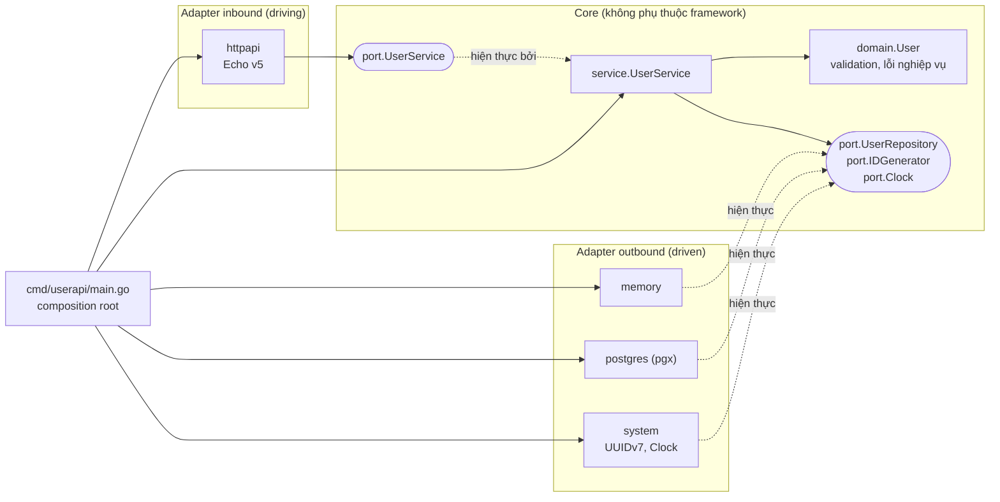

# userapi: Go + Echo v5 + Hexagonal Architecture

Repo mẫu cho một REST API quản lý user, tổ chức theo kiến trúc Hexagonal (Ports & Adapters). Repo nhỏ nhưng đầy đủ: domain có kiểm tra dữ liệu, hai adapter lưu trữ có thể hoán đổi (in-memory và PostgreSQL), lỗi HTTP theo chuẩn RFC 9457, log có cấu trúc bằng `slog`, graceful shutdown và bộ test nhiều tầng.

| Thành phần | Phiên bản |
|---|---|
| Go | 1.25 trở lên (đã kiểm tra với 1.26) |
| Echo | `github.com/labstack/echo/v5` v5.4.0 |
| PostgreSQL driver | `github.com/jackc/pgx/v5` v5.11.0 |
| PostgreSQL | 16 |

## Chạy nhanh

```bash
# 1. Không cần database: dữ liệu nằm trong RAM
make run                      # hoặc: go run ./cmd/userapi

# 2. Với PostgreSQL (cần Docker): khởi động DB, chạy migration, rồi chạy API
make run-pg

# 3. Toàn bộ stack trong container
make up
```

Thử API:

```bash
curl -i -X POST localhost:8080/api/v1/users \
  -H 'Content-Type: application/json' \
  -d '{"email":"Lan@Example.com","name":"Lan  Nguyen"}'
# 201 Created, Location: /api/v1/users/<uuid>
# email được chuẩn hoá thành chữ thường, khoảng trắng thừa trong name bị gộp

curl localhost:8080/api/v1/users?limit=10
```

File `api.http` có sẵn các request mẫu cho REST Client (VS Code) hoặc HTTP Client (JetBrains).

## Kiến trúc



**Quy tắc phụ thuộc** là quy tắc duy nhất phải giữ: mũi tên import luôn hướng vào trong. `domain` không import gì của dự án. `port` chỉ import `domain`. `service` chỉ import `domain` và `port`. Adapter import core, còn core không bao giờ import adapter. Chỉ `main.go` biết tất cả mọi thứ, vì đây là nơi lắp ráp.

Quy tắc này được **CI thực thi tự động** bằng `depguard` trong `.golangci.yml`, không dựa vào việc review bằng mắt:

| Rule | Ràng buộc |
|---|---|
| `core` | `internal/core/**` chỉ được import thư viện chuẩn và chính `internal/core` |
| `inbound-adapters` | Không import adapter outbound, driver database hay `internal/app` |
| `outbound-adapters` | Không import adapter inbound, Echo, adapter outbound khác, bộ test `repotest` hay `internal/app` |
| `platform` | `internal/config`, `internal/observability` không import core, adapter hay `internal/app` |

Test của core (`*_test.go`) được miễn, vì dùng repository in-memory làm test double là hợp lý. Chạy `make lint` để kiểm tra local.

### Cấu trúc thư mục

```
cmd/userapi/main.go                  composition root: config, chọn adapter, start/shutdown
internal/
  core/
    domain/        entity User, value object Email, ValidationError, ErrEmailAlreadyExists
    port/          interface: inbound (UserService) và outbound (UserRepository, IDGenerator, Clock); lỗi kết quả use case (ErrNotFound, ErrVersionConflict)
    service/       use case: Register, Get, List, Update (PATCH), Delete
  adapter/
    inbound/httpapi/        Echo v5: route, DTO, middleware, ánh xạ lỗi sang problem+json
    outbound/memory/        repository trong RAM (map + RWMutex)
    outbound/postgres/      repository pgx, migration goose nhúng bằng embed
    outbound/repotest/      contract test dùng chung cho mọi repository
    outbound/system/        sinh UUIDv7, đồng hồ UTC
  config/          đọc cấu hình từ biến môi trường
  observability/   slog handler theo ngữ cảnh request, khởi tạo OpenTelemetry
```

### Luồng một request `POST /api/v1/users`

1. `otelhttp` mở span, rồi Echo nhận request. Middleware chạy theo thứ tự: RequestID (gắn `request_id` vào ctx), đặt tên span theo route, request logger, Recover, BodyLimit (1 MiB), ContextTimeout (10s).
2. `httpapi.userHandler.create` bind JSON vào DTO `createUserRequest`, sau đó gọi `port.UserService.Register`. Handler không chứa logic nghiệp vụ.
3. `service.UserService.Register` lấy ID từ `IDGenerator` và thời gian từ `Clock`, rồi gọi `domain.NewUser` để chuẩn hoá và validate dữ liệu.
4. `UserRepository.Create` lưu bản ghi. Adapter postgres dịch lỗi unique violation (`23505`) thành `domain.ErrEmailAlreadyExists`.
5. Nếu thành công, handler trả 201 kèm header `Location`. Nếu có lỗi, handler chỉ cần `return err`, và `HTTPErrorHandler` tập trung sẽ ánh xạ lỗi đó sang HTTP.

## API

| Method | Path | Mô tả | Thành công |
|---|---|---|---|
| POST | `/api/v1/users` | Tạo user `{email, name}` | 201 |
| GET | `/api/v1/users?limit=&offset=` | Danh sách, mặc định limit 20, tối đa 100; offset tối đa 10.000 | 200 |
| GET | `/api/v1/users/{id}` | Lấy một user | 200 |
| PATCH | `/api/v1/users/{id}` | Cập nhật từng phần; field không gửi thì giữ nguyên. Hỗ trợ `If-Match` | 200 |
| DELETE | `/api/v1/users/{id}` | Xoá | 204 |
| GET | `/healthz` | Liveness: tiến trình còn sống | 200 |
| GET | `/readyz` | Readiness: 503 khi đang shutdown; ping database nếu bật `READINESS_CHECK_DB` | 200 / 503 |

Kết quả danh sách có dạng `{"data": [...], "meta": {"limit": 20, "offset": 0, "total": 42}}`.

### Cập nhật đồng thời (optimistic locking)

Mỗi user có trường `version`, tăng 1 sau mỗi thay đổi, và được trả kèm header `ETag: "<version>"` ở POST/GET/PATCH. Repository ghi bằng compare-and-set (`UPDATE ... WHERE id = $1 AND version = $n`), nên hai PATCH chạy song song không bao giờ âm thầm ghi đè thay đổi của nhau.

| Client gửi | Hành vi khi có xung đột |
|---|---|
| Không có `If-Match` (hoặc `*`) | Service tự đọc lại và áp dụng lại thay đổi, tối đa 3 lần. Vẫn xung đột thì trả **409** |
| `If-Match: "<version>"` | Version không khớp (client đang giữ dữ liệu cũ) thì trả **412**, không retry. Client cần GET lại rồi quyết định |

`If-Match` là tuỳ chọn để không phá vỡ client cũ. Client nào hiển thị form sửa cho người dùng nên gửi nó, vì đó là cách duy nhất phát hiện "người dùng sửa trên dữ liệu đã cũ".

### Định dạng lỗi (RFC 9457)

Mọi lỗi trả về `Content-Type: application/problem+json`:

```json
{
  "type": "about:blank",
  "title": "Unprocessable Entity",
  "status": 422,
  "detail": "request failed validation",
  "instance": "/api/v1/users",
  "errors": [
    {"field": "email", "message": "must be a valid email address"},
    {"field": "name",  "message": "is required"}
  ]
}
```

| Lỗi | HTTP |
|---|---|
| `*domain.ValidationError` | 422, kèm danh sách lỗi theo từng trường |
| `port.ErrNotFound` (kể cả id không đúng định dạng UUID) | 404 |
| `domain.ErrEmailAlreadyExists` | 409 |
| `port.ErrVersionConflict` khi không có `If-Match` (đã retry 3 lần) | 409 |
| `If-Match` không khớp version hiện tại | 412 |
| JSON hỏng, `limit`/`offset` không phải số | 400 |
| `offset` lớn hơn 10.000 | 422 |
| Client đóng kết nối trước khi có response (`context.Canceled`) | 499, log mức WARN, không tính là lỗi server |
| Route không tồn tại / sai method / body quá lớn | 404 / 405 / 413 |
| Lỗi không lường trước | 500, không lộ chi tiết nội bộ ra ngoài; lỗi gốc được ghi vào log |

Toàn bộ việc ánh xạ nằm trong một hàm duy nhất là `httpapi.toProblem`.

## Cấu hình

| Biến | Mặc định | Ý nghĩa |
|---|---|---|
| `HTTP_ADDR` | `:8080` | Địa chỉ lắng nghe |
| `STORAGE` | `memory` | `memory` hoặc `postgres` |
| `DATABASE_URL` | (trống) | Bắt buộc khi `STORAGE=postgres` |
| `LOG_LEVEL` | `info` | `debug`, `info`, `warn`, `error` |
| `SHUTDOWN_DELAY` | `0s` | Thời gian chờ sau SIGTERM trước khi ngừng nhận kết nối. Trên Kubernetes đặt 5s–10s |
| `SHUTDOWN_TIMEOUT` | `10s` | Thời gian chờ các request đang chạy hoàn tất, tính sau `SHUTDOWN_DELAY` |
| `REQUEST_TIMEOUT` | `10s` | Timeout của context cho mỗi request |
| `HTTP_IDLE_TIMEOUT` | `75s` | Thời gian giữ keep-alive connection rảnh; phải lớn hơn idle timeout của LB |
| `TRUSTED_PROXIES` | (trống) | CIDR của LB/ingress, phân tách bằng dấu phẩy. Khi có, IP client lấy từ `X-Forwarded-For` |
| `READINESS_CHECK_DB` | `false` | `/readyz` có ping database hay không (timeout 500ms) |
| `DB_MAX_CONNS` | `10` | Số kết nối tối đa **mỗi pod** |
| `DB_MIN_CONNS` | `0` | Số kết nối giữ sẵn |
| `DB_MAX_CONN_LIFETIME` | `30m` | Tuổi thọ tối đa của một kết nối (giúp cân bằng lại sau failover) |
| `DB_MAX_CONN_IDLE_TIME` | `5m` | Đóng kết nối rảnh quá lâu |
| `DB_STATEMENT_TIMEOUT` | `5s` | `statement_timeout` phía PostgreSQL |
| `OTEL_EXPORTER_OTLP_ENDPOINT` | (trống) | Endpoint OTLP/HTTP của collector. Trống = không export trace/metric. Các biến `OTEL_*` chuẩn khác (`OTEL_SERVICE_NAME`, `OTEL_TRACES_SAMPLER`...) đều được hỗ trợ |
| `MIGRATE_ON_START` | `false` | Chạy migration khi app khởi động. Tiện cho dev; production nên dùng `userapi migrate` |

Cấu hình sai sẽ làm tiến trình dừng ngay khi khởi động, và mọi lỗi được báo cùng một lúc.

## Observability

**Log.** JSON ra stdout, mỗi request một dòng `http_request` (trừ `/healthz`, `/readyz`): 2xx/3xx ghi mức INFO, 4xx ghi mức WARN, 5xx ghi mức ERROR kèm lỗi gốc. `observability.ContextHandler` tự thêm `request_id`, `trace_id`, `span_id` vào **mọi** dòng log ghi bằng `slog.*Context(ctx, ...)` ở bất kỳ tầng nào, không cần truyền logger qua từng hàm. Ví dụ: service ghi log khi gặp xung đột version và phải retry, dòng log đó tự gắn với request và trace tương ứng.

**Trace và metric (OpenTelemetry).** Bật bằng `OTEL_EXPORTER_OTLP_ENDPOINT`. Khi không đặt, provider là no-op: không tốn chi phí đáng kể và không có exporter nào cố kết nối rồi ghi log lỗi.

| Nguồn | Thu được |
|---|---|
| `otelhttp` (bọc ngoài Echo) | Span mỗi request, tên theo route (`GET /api/v1/users/:id`, không theo URL thật để giữ cardinality thấp); metric `http.server.request.duration` có `http.route` |
| `otelpgx` | Span mỗi query (chỉ câu SQL, **không** kèm giá trị tham số để không lộ PII) và span chờ lấy kết nối từ pool; metric của pool (kết nối đang dùng, thời gian chờ acquire) |

Probe không bị trace. Trace context từ upstream (`traceparent`) luôn được chuyển tiếp. Khi tắt, app flush span/metric còn trong bộ đệm trước khi thoát. Version của build (`-ldflags "-X main.version=..."`) được ghi vào resource `service.version` và dòng log khởi động.

## Triển khai production

**Timeout của HTTP server.** `ReadHeaderTimeout` 5s chặn Slowloris; `WriteTimeout` lớn hơn `REQUEST_TIMEOUT` để handler kịp trả lỗi timeout; `HTTP_IDLE_TIMEOUT` (75s) phải lớn hơn idle timeout của LB. Nếu server đóng keep-alive connection *trước* LB (ví dụ 30s so với 60s của AWS ALB), LB có thể gửi request vào đúng connection vừa bị đóng và trả 502 cho client, lỗi lác đác rất khó tìm nguyên nhân.

**Shutdown không làm rơi request.** Khi nhận SIGTERM, app đánh dấu `/readyz` là 503, **vẫn phục vụ bình thường** trong `SHUTDOWN_DELAY`, rồi mới đóng listener và chờ tối đa `SHUTDOWN_TIMEOUT` cho request đang chạy. Lý do: Kubernetes gỡ pod khỏi Endpoints và cập nhật kube-proxy/ingress *bất đồng bộ* với SIGTERM; đóng listener ngay sẽ gây 502 ở mỗi lần rolling deploy. Image distroless không có lệnh `sleep` cho `preStop` kiểu exec; Kubernetes 1.30+ có action `preStop.sleep` dựng sẵn, nhưng chờ trong app thì chạy được trên mọi nền tảng. Đặt `terminationGracePeriodSeconds` lớn hơn `SHUTDOWN_DELAY + SHUTDOWN_TIMEOUT` (ví dụ 5s + 10s → 30s). Nhấn Ctrl+C lần hai để thoát ngay khi chạy local.

**Readiness không phụ thuộc database dùng chung.** Nếu `/readyz` ping database, một sự cố database vài giây sẽ làm *mọi* pod cùng lúc unready, service mất hết endpoint và client nhận 503 từ LB thay vì nhận lỗi nhanh rồi tự hồi phục khi database trở lại. Vì vậy mặc định readiness chỉ phản ánh trạng thái của chính pod. Theo dõi sức khoẻ database bằng metrics và alert.

**Kích thước pool.** Mặc định của pgx là `max(4, runtime.NumCPU())`, và trong container `NumCPU` là số core của *node*, không phải CPU limit của pod. Luôn đặt `DB_MAX_CONNS` sao cho `DB_MAX_CONNS × số replica (lúc HPA scale tối đa, cộng thêm pod của lần deploy) < max_connections` của PostgreSQL, chừa chỗ cho migration và kết nối quản trị. Khi số replica lớn, đặt PgBouncer phía trước.

**IP client.** Sau LB, `RemoteAddr` là IP của LB. Đặt `TRUSTED_PROXIES` bằng đúng dải IP của LB/ingress; app chỉ tin các hop `X-Forwarded-For` nằm trong dải này (các dải private mặc định *không* được tin, vì mọi pod trong cluster đều nằm trong mạng private).

**Xác thực.** Template **không có xác thực**, và `GET /api/v1/users` trả email của mọi user. Gắn middleware xác thực/phân quyền qua `httpapi.Options.APIMiddleware` (chỉ áp cho `/api/v1`, không áp cho probe) trước khi đưa lên môi trường thật.

## Test

```bash
make test               # unit + HTTP, không cần database
make test-integration   # thêm contract test trên PostgreSQL (TRUNCATE bảng users!)
make lint               # golangci-lint, gồm depguard
```

| Tầng | Ở đâu | Kiểm tra gì |
|---|---|---|
| Domain | `core/domain/*_test.go` | Chuẩn hoá, validate, `Apply` không làm thay đổi bản gốc |
| Service | `core/service/*_test.go` | Use case, dùng clock và ID giả để kết quả tất định |
| Contract | `adapter/outbound/repotest` | **Cùng một bộ test** chạy cho memory và postgres, gồm cả compare-and-set theo version |
| Đồng thời | `adapter/outbound/postgres/*_test.go` | 20 goroutine cùng update một user trên PostgreSQL thật: version cuối = 1 + số lần ghi thành công |
| HTTP | `adapter/inbound/httpapi/*_test.go` | Luồng CRUD, problem+json, ETag/If-Match, 499, IP qua proxy tin cậy, probe không bị log/trace, tên span theo route |
| Observability | `observability/*_test.go` | `request_id`/`trace_id` được gắn vào log từ ctx |
| Config | `config/*_test.go` | Giá trị mặc định và lỗi cấu hình |

**CI** (`.github/workflows/ci.yml`): lint (golangci-lint + depguard, `go mod tidy` sạch), test với `-race` trên một PostgreSQL service container (nên contract test và test đồng thời luôn chạy), chạy migration hai lần để chắc chắn idempotent, `govulncheck`, và build Docker image.

Integration test dùng PostgreSQL do CI (service container) hoặc `docker compose` cung cấp, qua `TEST_DATABASE_URL`, thay vì testcontainers-go. Lý do: testcontainers kéo thêm vài chục dependency gián tiếp (Docker client...) vào `go.mod` chỉ để dựng một container mà CI và compose đã dựng sẵn. Khi dự án cần nhiều loại hạ tầng (Kafka, Redis...) trong test thì testcontainers mới đáng giá.

Contract test là thứ đảm bảo kiến trúc giữ đúng lời hứa: một adapter mới chỉ được coi là đúng khi nó vượt qua `repotest.Run`.

## Các quyết định thiết kế

**Validate trong domain, không dùng thư viện validator qua struct tag.** Quy tắc nghiệp vụ (email hợp lệ, name tối đa 100 ký tự Unicode) thuộc về domain. Nhờ vậy mọi adapter inbound sau này (gRPC, CLI, consumer từ queue) đều được hưởng cùng một quy tắc, và repo bớt được khoảng chục dependency gián tiếp.

**DTO và persistence model tách khỏi entity.** `userResponse` (JSON) và `userRow` (SQL) là hai struct riêng. Đổi tên cột hay đổi định dạng JSON không đụng tới domain.

**Id không hợp lệ trả 404 thay vì 400.** Service kiểm tra `UserID.Valid()` trước khi gọi repository. Cách này tránh gửi chuỗi rác xuống PostgreSQL (vốn sẽ gây lỗi `22P02`), và không tiết lộ định dạng id cho client.

**UUIDv7 qua `google/uuid`.** ID tăng dần theo thời gian giúp index B-tree ít bị phân mảnh. Generator đứng sau port `IDGenerator`, nên đổi thuật toán chỉ cần viết một adapter mới.

**`Email` là value object.** Chỉ tạo được qua `domain.ParseEmail` (đã chuẩn hoá và hợp lệ), nên không thể gán chuỗi rác vào `User.Email`. Adapter lưu trữ dựng lại bằng `domain.EmailFromStore`, hàm này **cố ý không validate lại**: nếu sau này quy tắc được thắt chặt, bản ghi cũ vẫn đọc được thay vì làm mọi request liên quan lỗi 500. Các field khác của `User` vẫn exported: trong Go, private hoá toàn bộ kèm getter tạo nhiều boilerplate mà lợi ích không tương xứng; chỉ những giá trị có invariant riêng mới cần kiểu riêng.

**Inbound port chỉ nhận primitive.** `port.UpdateUserCmd` và tham số của `Get`/`Delete` là `string`, `*string`, `int64`, không phải `domain.UserID` hay `domain.Changes`. Mọi transport (HTTP hôm nay, gRPC hay consumer từ queue sau này) dùng chung một hợp đồng mà không phải tự dựng kiểu domain, và việc validate ID nằm ở một chỗ duy nhất trong core thay vì phụ thuộc vào việc mỗi adapter nhớ gọi `Valid()`. Kết quả trả về vẫn là `domain.User`; adapter được phép đọc kiểu domain.

**Domain không mang tag JSON.** `domain.FieldError` được map sang DTO `fieldError` trong `httpapi`; định dạng JSON thuộc về adapter.

**`Clock` là một port.** Test của service hoàn toàn tất định. Đồng hồ thật làm tròn thời gian xuống micro giây để khớp độ chính xác của PostgreSQL, nhờ đó dữ liệu đọc lại bằng đúng dữ liệu đã ghi.

**Optimistic locking thay vì `SELECT ... FOR UPDATE`.** Compare-and-set trên cột `version` chỉ cần một câu `UPDATE`, không giữ lock hay transaction giữa lúc đọc và ghi, và cùng cơ chế đó cung cấp luôn `ETag`. Đánh đổi: khi rất nhiều request cùng sửa *một* bản ghi, một phần sẽ nhận 409 và phải thử lại. Với dữ liệu kiểu hồ sơ user (tranh chấp thấp) đây là lựa chọn phù hợp.

**Migration bằng goose, chạy tách khỏi app.** Xem mục "Migration" bên dưới.

## Migration

Migration là file SQL trong `internal/adapter/outbound/postgres/migrations`, nhúng vào binary và chạy bằng [goose](https://github.com/pressly/goose):

```bash
userapi migrate      # hoặc: make migrate
```

- Bảng `goose_db_version` ghi lại version đã chạy; mỗi file chạy đúng một lần, trong transaction riêng.
- Advisory lock giữ trên một kết nối duy nhất, nên nhiều Job/replica chạy `migrate` cùng lúc vẫn an toàn (đã kiểm tra với 3 tiến trình song song).
- Phiên migration dùng kết nối riêng với `statement_timeout = 0` (tạo index có thể lâu) và `lock_timeout = 5s`: nếu `ALTER TABLE` phải chờ lock, nó thất bại sớm thay vì làm mọi query khác trên bảng xếp hàng phía sau.
- Khi khởi động, app kiểm tra còn migration chưa chạy không và **dừng ngay** với thông báo rõ ràng, thay vì chạy rồi lỗi `column does not exist`.

**Trên Kubernetes:** chạy `userapi migrate` bằng một Job (Helm pre-upgrade hook, Argo CD PreSync) hoặc initContainer, dùng **cùng image** với app. Giữ `MIGRATE_ON_START=false`. `docker compose up` mô phỏng đúng mô hình này với service `migrate`.

**Phân quyền.** Tách hai role: role migration sở hữu schema (DDL), role của app chỉ có DML. App bị lộ thông tin đăng nhập cũng không thể `DROP TABLE`.

```sql
CREATE ROLE userapi_migrator LOGIN PASSWORD '...';
CREATE ROLE userapi_app      LOGIN PASSWORD '...';
GRANT USAGE ON SCHEMA public TO userapi_app;
ALTER DEFAULT PRIVILEGES FOR ROLE userapi_migrator IN SCHEMA public
    GRANT SELECT, INSERT, UPDATE, DELETE ON TABLES TO userapi_app;
```

**Viết migration an toàn khi rolling deploy (expand/contract).** Trong lúc deploy, pod cũ và pod mới cùng chạy trên schema mới, nên mọi migration phải tương thích ngược với code đang chạy:

| Muốn | Làm |
|---|---|
| Thêm cột | Thêm cột nullable hoặc có `DEFAULT` (như `0002_add_users_version.sql`) |
| Đổi tên / xoá cột | Thêm cột mới → deploy code ghi cả hai → backfill → deploy code chỉ đọc cột mới → xoá cột cũ ở lần deploy sau |
| Tạo index trên bảng lớn | `CREATE INDEX CONCURRENTLY` trong file riêng có dòng `-- +goose NO TRANSACTION` (CONCURRENTLY không chạy được trong transaction) |
| Thêm `NOT NULL` / foreign key | `ADD CONSTRAINT ... NOT VALID`, sau đó `VALIDATE CONSTRAINT` ở migration riêng |

## Ghi chú khi chuyển từ Echo v4 sang v5

| Echo v4 | Echo v5 (repo này dùng) |
|---|---|
| `func(c echo.Context) error` (interface) | `func(c *echo.Context) error` (struct) |
| `e.Start(addr)` + `e.Shutdown(ctx)` thủ công | `echo.StartConfig{Address, GracefulTimeout}.Start(ctx, e)`, tự shutdown khi `ctx` bị huỷ. Repo này vẫn tự dựng `http.Server` để đặt `ReadHeaderTimeout`/`IdleTimeout` và bọc `otelhttp` bên ngoài Echo |
| `e.Logger` riêng của Echo | `e.Logger` là `*slog.Logger` |
| `c.Bind` + `strconv` cho query | `echo.BindBody`, generic `echo.QueryParamOr[int](c, "limit", 0)` |
| Kiểu lỗi chỉ có `*echo.HTTPError` | Thêm interface `HTTPStatusCoder`; dùng `echo.StatusCode(err)` để lấy status |

## Mở rộng

**Thêm adapter lưu trữ mới** (ví dụ MySQL): tạo `internal/adapter/outbound/mysql`, hiện thực `port.UserRepository`, viết test gọi `repotest.Run`, rồi thêm một nhánh `case` trong `main.go`. Không cần sửa dòng nào trong `core`.

**Thêm transport mới** (ví dụ gRPC): tạo `internal/adapter/inbound/grpcapi` nhận vào `port.UserService`, ánh xạ lỗi domain sang `codes.NotFound`, `codes.AlreadyExists`..., rồi khởi động song song trong `main.go`.

**Use case ghi nhiều repository trong một transaction** (ví dụ tạo user và ghi outbox event): thêm port Unit of Work *tường minh*, trong đó transaction được truyền qua kiểu dữ liệu, không giấu trong `context`:

```go
// port
type Repos struct {
    Users  UserRepository
    Outbox OutboxRepository
}
type UnitOfWork interface {
    // Do chạy fn trong một transaction; fn trả lỗi thì rollback.
    Do(ctx context.Context, fn func(ctx context.Context, r Repos) error) error
}
```

Adapter postgres hiện thực `Do` bằng `pgx.BeginTxFunc` và dựng `Repos` trên `pgx.Tx`; adapter memory khoá mutex rồi gọi `fn`. Template chưa thêm port này vì chưa có use case nào cần (thêm abstraction không được dùng là nợ kỹ thuật). Không nên dùng cách giấu `pgx.Tx` trong `context`: repository quên lấy tx từ context sẽ âm thầm chạy ngoài transaction, và goroutine con có thể dùng tx sau khi đã commit.

**Thêm use case** (ví dụ tìm theo email): thêm method vào `port.UserService` và `port.UserRepository`, hiện thực ở service, thêm test vào `repotest` để mọi adapter cùng bị kiểm tra, rồi thêm handler.

## Đổi module path

Repo dùng module path giả là `github.com/example/userapi`. Để đổi sang path của bạn:

```bash
NEW=github.com/<you>/userapi
go mod edit -module $NEW
grep -rl github.com/example/userapi --include='*.go' . | xargs sed -i "s#github.com/example/userapi#$NEW#g"
go build ./... && go test ./...
```
