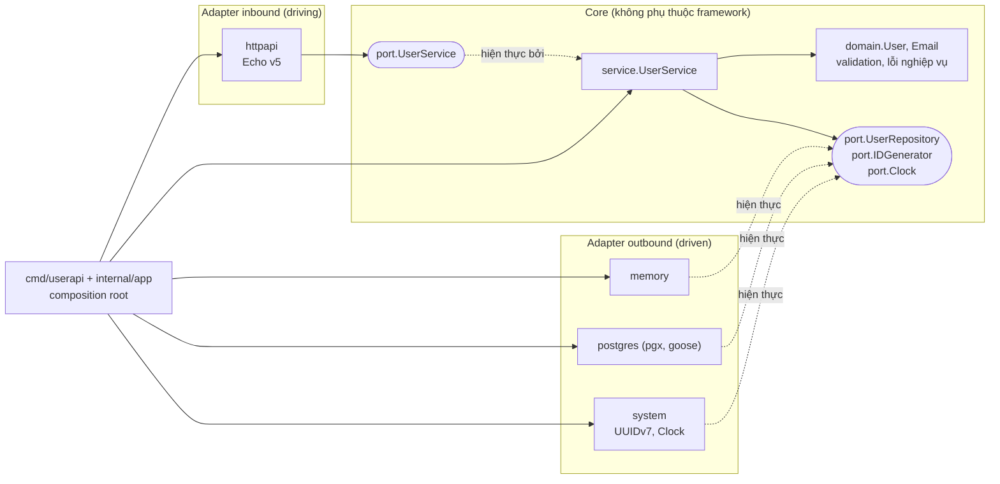

# Kiến trúc

Tài liệu cho người phát triển trên template: kiến trúc Hexagonal, quy tắc phụ thuộc, luồng xử lý một request, các quyết định thiết kế và cách mở rộng.

## Tổng quan



## Quy tắc phụ thuộc

Mũi tên import luôn hướng vào trong:
- `domain` không import gì của dự án;
- `port` chỉ import `domain`;
- `service` chỉ import `domain` và `port`;
- adapter import core, còn core không bao giờ import adapter.

Chỉ composition root biết tất cả. `cmd/userapi/main.go` chỉ đọc config, tạo logger, bắt tín hiệu và gọi `app.Run`. `internal/app` lắp adapter vào core và quản lý vòng đời server, để phần này có test tự động.

Quy tắc được **CI thực thi tự động** bằng `depguard` (`.golangci.yml`); chạy `make lint` để kiểm tra local:

| Rule | Ràng buộc |
|---|---|
| `core` | `internal/core/**` chỉ được import thư viện chuẩn và chính `internal/core/...`, trừ `net/http`, `database/sql` và `os` (HTTP, SQL và biến môi trường thuộc về adapter và composition root) |
| `inbound-adapters` | Không import adapter outbound, `internal/app`, hay bất kỳ package database nào (`pgx`, `database/sql`, `goose`, `otelpgx`) |
| `outbound-adapters` | Không import adapter inbound, Echo, adapter outbound khác, bộ test `repotest` hay `internal/app` |
| `platform` | `internal/config`, `internal/observability` không import core, adapter hay `internal/app` |
| `cmd` | `cmd/**` không import adapter, core, `pgx` hay Echo: việc lắp ráp nằm trong `internal/app` |
| `everything-else` | Mọi package còn lại, kể cả package mới (ví dụ `internal/worker`), không import adapter, `internal/app`, `pgx`, `goose` hay Echo. Package mới cần quyền đó thì phải có rule riêng |

Mọi rule đều bỏ qua file `*_test.go`, vì test được phép dùng adapter làm test double (ví dụ test của service dùng repository in-memory). Hướng import *bên trong* core (`domain` ← `port` ← `service`) không cần rule: import ngược sẽ tạo vòng import, và Go từ chối biên dịch.

Ngoài depguard, hai linter chỉ áp dụng cho `internal/core` (trừ test) giữ quy tắc "core không có state toàn cục":
- `forbidigo` cấm `time.Now` (dùng `port.Clock`) và logger toàn cục `slog.Info`/`slog.Default`... (dùng `*slog.Logger` được inject);
- `gochecknoglobals` cấm biến package-level, trừ sentinel error (`ErrXxx`) và `var _ Interface = ...`.

## Luồng một request `POST /api/v1/users`

1. `otelhttp` (bọc ngoài Echo) mở span.
2. Echo chạy middleware theo thứ tự:
   - `dropInvalidRequestID` bỏ `X-Request-Id` không hợp lệ do client gửi;
   - RequestID gắn `request_id` vào ctx;
   - đặt tên span theo route;
   - request logger;
   - Recover;
   - BodyLimit (1 MiB);
   - ContextTimeout (`REQUEST_TIMEOUT`).
3. `httpapi.userHandler.create` bind JSON vào DTO `createUserRequest` rồi gọi `port.UserService.Register`. Handler không chứa logic nghiệp vụ.
4. `service.UserService.Register` lấy ID từ `IDGenerator`, thời gian từ `Clock`, rồi gọi `domain.NewUser` để chuẩn hoá và validate.
5. `UserRepository.Create` lưu bản ghi. Adapter postgres dịch lỗi unique violation (`23505`) thành `domain.ErrEmailAlreadyExists`.
6. Handler trả 201 kèm `Location` và `ETag`. Nếu có lỗi, handler chỉ cần `return err`; `HTTPErrorHandler` tập trung dùng `httpapi.toProblem` để ánh xạ lỗi sang problem+json. Ngoại lệ duy nhất: handler `update` tự quyết định trả 412 khi client gửi `If-Match` mà version xung đột.

## Phân loại lỗi

| Lỗi | Thuộc về | Ý nghĩa |
|---|---|---|
| `domain.ValidationError` | Domain | Dữ liệu vi phạm invariant, kèm danh sách field |
| `domain.ErrEmailAlreadyExists` | Domain | Quy tắc nghiệp vụ: email là duy nhất |
| `port.ErrNotFound` | Application | Không tìm thấy, dùng chung cho mọi aggregate |
| `port.ErrVersionConflict` | Application | Bản ghi bị thay đổi kể từ lúc đọc (optimistic locking) |

Repository trả sentinel trần; service wrap kèm ngữ cảnh (`fmt.Errorf("user %s: %w", id, port.ErrNotFound)`). Luôn so sánh bằng `errors.Is`/`errors.As`. Core không biết HTTP status; mỗi adapter inbound tự ánh xạ lỗi sang giao thức của mình.

## Quyết định thiết kế

**Validate trong domain, không dùng thư viện validator qua struct tag.** Quy tắc nghiệp vụ (email hợp lệ, name tối đa 100 ký tự Unicode) thuộc về domain, nên mọi adapter inbound (gRPC, CLI, consumer từ queue) được hưởng cùng một quy tắc, và repo bớt khoảng chục dependency gián tiếp.

**DTO và persistence model tách khỏi entity.** `userResponse` (JSON) và `userRow` (SQL) là hai struct riêng. Đổi tên cột hay đổi định dạng JSON không đụng tới domain. `domain.FieldError` cũng không mang tag JSON; `httpapi` map nó sang DTO riêng.

**Inbound port chỉ nhận primitive.** `port.UpdateUserCmd` và tham số của `Get`/`Delete` là `string`, `*string`, `int64`, không phải `domain.UserID` hay `domain.Changes`. Mọi transport dùng chung một hợp đồng mà không phải tự dựng kiểu domain, và việc validate ID nằm ở một chỗ duy nhất trong core. Kết quả trả về vẫn là `domain.User`; adapter được phép đọc kiểu domain.

**ID không hợp lệ trả 404 thay vì 400.** Service validate ID trước khi gọi repository. Cách này tránh gửi chuỗi rác xuống PostgreSQL (vốn gây lỗi `22P02`) và không tiết lộ định dạng ID cho client.

**`Email` là value object.** Chỉ tạo được qua `domain.ParseEmail` (đã chuẩn hoá và hợp lệ), nên không thể gán chuỗi rác vào `User.Email`. Adapter lưu trữ dựng lại bằng `domain.EmailFromStore`, hàm này **cố ý không validate lại**: nếu sau này quy tắc được thắt chặt, bản ghi cũ vẫn đọc được thay vì làm mọi request liên quan lỗi 500. Các field khác của `User` vẫn exported: trong Go, private hoá toàn bộ kèm getter tạo nhiều boilerplate mà lợi ích không tương xứng.

**`Clock` và `IDGenerator` là port.** Test của service hoàn toàn tất định. Đồng hồ thật làm tròn thời gian xuống micro giây để khớp độ chính xác của PostgreSQL. ID là UUIDv7 qua `google/uuid`: tăng dần theo thời gian nên index B-tree ít bị phân mảnh.

**Logger được truyền vào service, không dùng logger toàn cục.** Test bắt được log, và mỗi instance có thể ghi log ra nơi khác nhau.

**Optimistic locking thay vì `SELECT ... FOR UPDATE`.** Compare-and-set trên cột `version` chỉ cần một câu `UPDATE`, không giữ lock hay transaction giữa lúc đọc và ghi, và cùng cơ chế đó cung cấp luôn `ETag`. Đánh đổi: khi rất nhiều request cùng sửa *một* bản ghi, một phần sẽ nhận 409. Với dữ liệu kiểu hồ sơ user (tranh chấp thấp) đây là lựa chọn phù hợp.

**Migration bằng goose, chạy tách khỏi app.** App chỉ đọc trạng thái migration lúc khởi động; DDL chỉ chạy bằng lệnh `userapi migrate` với role riêng. Xem [operations.md](operations.md#migration).

**Integration test dùng PostgreSQL thật qua `TEST_DATABASE_URL`, không dùng testcontainers-go.** CI (service container) và `docker compose` đã dựng sẵn PostgreSQL; testcontainers kéo thêm vài chục dependency gián tiếp chỉ để làm việc đó. Khi test cần nhiều loại hạ tầng (Kafka, Redis...), testcontainers mới đáng giá.

## Mở rộng

**Thêm adapter lưu trữ mới** (ví dụ MySQL):
1. Tạo `internal/adapter/outbound/mysql`, hiện thực `port.UserRepository`.
2. Viết test gọi `repotest.Run`. Adapter chỉ được coi là đúng khi vượt qua bộ contract test này.
3. Trong `internal/config/config.go`, thêm hằng `StorageMySQL` và nhánh tương ứng trong phần validate `STORAGE`; nếu không, config sẽ từ chối giá trị mới.
4. Trong `newRepository` (`internal/app/app.go`), thêm nhánh dựng adapter mới. Quên bước này thì app từ chối khởi động với lỗi `unsupported storage "mysql"`.
5. Thêm đường dẫn package mới vào danh sách deny của rule `outbound-adapters` trong `.golangci.yml`, để các adapter outbound khác không import nó.

Không cần sửa dòng nào trong `internal/core`.

**Thêm transport mới** (ví dụ gRPC): tạo `internal/adapter/inbound/grpcapi` nhận vào `port.UserService`, ánh xạ lỗi của core (`port.ErrNotFound` → `codes.NotFound`, `domain.ErrEmailAlreadyExists` → `codes.AlreadyExists`, `port.ErrVersionConflict` → `codes.Aborted`, `domain.ValidationError` → `codes.InvalidArgument`), rồi khởi động song song trong `app.Run`.

**Thêm use case** (ví dụ tìm theo email):
1. Thêm method vào `port.UserService`, với tham số là kiểu primitive.
2. Nếu cần, thêm method vào `port.UserRepository` và thêm test vào `repotest`, để mọi adapter cùng bị kiểm tra.
3. Hiện thực ở service và thêm handler.

**Use case ghi nhiều repository trong một transaction** (ví dụ tạo user và ghi outbox event): thêm port Unit of Work *tường minh*, trong đó transaction được truyền qua kiểu dữ liệu, không giấu trong `context`:

```go
// port
type Repos struct {
    Users  UserRepository
    Outbox OutboxRepository
}
type UnitOfWork interface {
    // Do chạy fn trong một transaction; fn trả lỗi thì rollback.
    Do(ctx context.Context, fn func(ctx context.Context, r Repos) error) error
}
```

Adapter postgres hiện thực `Do` bằng `pgx.BeginTxFunc` và dựng `Repos` trên `pgx.Tx`; adapter memory khoá mutex rồi gọi `fn`. Template chưa thêm port này vì chưa có use case nào cần (thêm abstraction không được dùng là nợ kỹ thuật). Không nên giấu `pgx.Tx` trong `context`: repository quên lấy tx từ context sẽ âm thầm chạy ngoài transaction, và goroutine con có thể dùng tx sau khi đã commit.

**Khi có aggregate thứ hai:** cân nhắc tổ chức package theo bounded context (`internal/user/{domain,app,adapter}`, `internal/order/...`, hạ tầng dùng chung ở `internal/platform`) thay vì theo layer như hiện tại.

## Ghi chú khi chuyển từ Echo v4 sang v5

| Echo v4 | Echo v5 (repo này dùng) |
|---|---|
| `func(c echo.Context) error` (interface) | `func(c *echo.Context) error` (struct) |
| `e.Start(addr)` + `e.Shutdown(ctx)` thủ công | `echo.StartConfig{Address, GracefulTimeout}.Start(ctx, e)`. Repo này vẫn tự dựng `http.Server` để đặt `ReadHeaderTimeout`/`IdleTimeout` và bọc `otelhttp` bên ngoài Echo |
| `e.Logger` riêng của Echo | `e.Logger` là `*slog.Logger` |
| `c.Bind` + `strconv` cho query | `echo.BindBody`, generic `echo.QueryParamOr[int](c, "limit", 0)` |
| Kiểu lỗi chỉ có `*echo.HTTPError` | Thêm interface `HTTPStatusCoder`; dùng `echo.StatusCode(err)` để lấy status |
