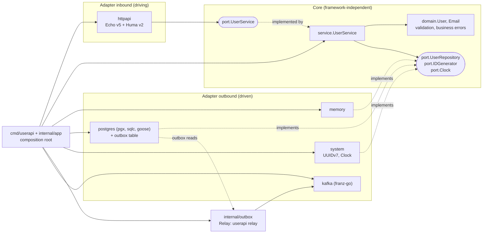

# Architecture

Developer reference: Hexagonal Architecture, dependency rules, request flow, design decisions, and extension points.

## Overview



## Dependency rules

Imports always point inward:
- `domain` imports no project packages;
- `port` imports only `domain`;
- `service` imports only `domain` and `port`;
- adapters import core; core never imports adapters.

Only the composition root knows all components. `cmd/userapi/main.go` reads config, creates a logger (also setting the default for libraries), handles signals, and calls `app.Run`, `app.Migrate`, or `app.RunRelay`. `internal/app` wires adapters into core with [Uber Fx](https://github.com/uber-go/fx) and manages the server lifecycle so it can be tested. Only `internal/app` imports fx: core and adapters expose plain constructors, and `cmd` still owns signals and the exit code.

Lifecycle order (fx runs `OnStart` hooks in registration order and `OnStop` in reverse):

| Command | Start | Stop |
|---|---|---|
| `userapi` | telemetry → pool (ping, `MIGRATE_ON_START`, pending check) → HTTP listen/serve | drain HTTP (`/readyz` 503, `SHUTDOWN_DELAY`, `SHUTDOWN_TIMEOUT`) → close pool → flush telemetry |
| `userapi relay` | telemetry → Kafka ping → pool → relay loop → health server | health server → relay loop → close pool → close Kafka client → flush telemetry |

Resources open in `OnStart`, not in constructors, because fx stops only hooks that started. Start hooks that wait on the database or broker still abort when a signal arrives during startup. A runtime failure of the HTTP server or relay loop stops the app with an error.

CI **automatically enforces** these rules through `depguard` (`.golangci.yml`); run `make lint` locally:

| Rule | Constraint |
|---|---|
| `core` | `internal/core/**` imports only the standard library and `internal/core/...`, excluding `net/http`, `database/sql`, and `os` (HTTP, SQL, and environment access belong to adapters/composition root) |
| `inbound-adapters` | No outbound adapters, `internal/app`, database packages (`pgx`, `database/sql`, `goose`, `otelpgx`), Kafka clients (`franz-go`), `internal/outbox`, or fx/dig |
| `outbound-adapters` | No inbound adapters, Echo, Huma, other outbound adapters, shared `repotest`, `internal/app`, or fx/dig |
| `outbound-adapters-not-postgres` | Other outbound adapters cannot import the postgres adapter or its generated `postgres/sqlcgen`; the postgres adapter itself is exempt, so it can import `sqlcgen` |
| `outbound-adapters-no-broker` | Outbound adapters except `kafka` cannot import `franz-go`: events go through the outbox, never direct publishing |
| `outbox` | `internal/outbox` uses only the standard library: no database, broker, or domain |
| `platform` | `internal/config` and `internal/observability` cannot import core, adapters, `internal/outbox`, `internal/app`, or fx/dig |
| `cmd` | `cmd/**` cannot import adapters, core, `pgx`, `goose`, Echo, Huma, `franz-go`, or fx/dig: wiring belongs in `internal/app` |
| `everything-else` | All remaining packages, including `internal/outbox` and new packages such as `internal/worker`, cannot import adapters, `internal/app`, `pgx`, `goose`, Echo, Huma, `franz-go`, or fx/dig. New package categories needing access require their own rule |

Rules exclude `*_test.go` because tests may use adapters as test doubles (such as memory repositories in service tests). Reverse imports *inside* core (`domain` ← `port` ← `service`) would create import cycles rejected by Go.

Two additional linters apply only to non-test `internal/core` code to enforce no global state:
- `forbidigo` bans `time.Now` (use `port.Clock`) and global logging such as `slog.Info`/`slog.Default` (inject `*slog.Logger`);
- `gochecknoglobals` bans package-level variables except sentinel errors (`ErrXxx`) and `var _ Interface = ...` assertions.

## Flow of `POST /api/v1/users`

1. `otelhttp`, wrapping Echo, starts a span.
2. Echo runs middleware in order:
   - `dropInvalidRequestID` removes invalid client-supplied `X-Request-Id`;
   - RequestID attaches `request_id` to ctx;
   - name the span after its route;
   - request logger;
   - Recover;
   - BodyLimit (1 MiB);
   - ContextTimeout (`REQUEST_TIMEOUT`).
3. Echo routes the request to the Huma operation `createUser`, registered on the `/api/v1` group so `APIMiddleware` runs first. `createUserInput.Resolve` reads the body with `bindJSON`; `httpapi.userHandler.create` calls `port.UserService.Register`. The handler contains no business logic.
4. `service.UserService.Register` obtains an ID from `IDGenerator` and time from `Clock`, then calls `domain.NewUser` to normalize and validate.
5. `UserRepository.Create` stores the record. PostgreSQL maps unique violation `23505` on `users_email_key` to `domain.ErrEmailAlreadyExists`; violations of other constraints remain unexpected errors (500).
6. The handler returns `createUserOutput`; Huma writes 201 with `Location`, `ETag`, and the body. For errors, the handler returns the error and `register` maps it through `httpapi.toProblem` into problem+json; errors raised outside operations (unknown routes, 405, panics) reach the same `toProblem` through Echo's `HTTPErrorHandler`. Handlers create only HTTP-layer errors: malformed bodies/queries (400, 413, 415), invalid If-Match (412), and version conflicts with If-Match (412). Business errors originate in core.

## HTTP adapter: Echo and Huma

Echo owns routing, middleware, and probes; Huma v2 provides typed operations and generates the OpenAPI 3.1 document from them. `internal/app` still owns the `http.Server`.

| Part | Where | Why |
|---|---|---|
| `humaAdapter` | `httpapi/huma_adapter.go` | Runs operations on Echo v5. Huma's own `humaecho` package is not imported: it also contains an Echo v4 adapter, which would link Echo v4, `gommon`, and `x/crypto/acme` into the binary. Operations under `/api/v1` register on the Echo group, so `APIMiddleware` and unknown-route handling behave as for native routes |
| Input `Resolve` methods | `httpapi/user_handler.go` | Read the body, `If-Match`, and pagination with `bindJSON`, `parseIfMatch`, and `echo.QueryParamOr`. Huma's own parsing and validation would change statuses and details (for example 422 instead of 400 for a non-integer `limit`, or a body required on PATCH); `register` documents `RequestBody` without letting Huma read it |
| Errors | `httpapi/openapi.go` | Handlers return errors; `register` wraps them in `apiError` (built by `toProblem`), which Huma writes as problem+json. `huma.NewError` is process-global and is never replaced |
| OpenAPI | `httpapi/openapi.go` | Generated once per server, so independently built servers share no state. `API_DOCS_ENABLED=true` serves it at `/openapi.json` with SwaggerUI at `/docs`, outside `APIMiddleware` |

`testdata/*.golden` in `httpapi` pin every status, header, and body byte of the API: a contract change shows up as a golden diff.

To add an operation:
1. Write the contract test first (`user_handler_test.go`, and a `contract_test.go` exchange if it changes the wire format).
2. Define input and output structs in `user_handler.go`. Path parameters use typed `path:"..."` fields of type `string`; everything Huma would validate differently (bodies, numbers, repeated headers) is read in the input's `Resolve(huma.Context)` and returned by the handler as an error.
3. Register the operation in `userHandler.register` with an `OperationID`, the `Users` tag, `DefaultStatus`, `jsonBody[...]` for a body, `Parameters` for values read in `Resolve`, and `problemResponses` for every error status it can return.
4. Check the document with `TestAPIDocs_*` and update `docs/api.md`.

## PostgreSQL adapter: sqlc and pgx

Queries are SQL files compiled by [sqlc](https://docs.sqlc.dev) into typed pgx/v5 code. The repository still owns transactions, error mapping, events, and conversion to domain types; sqlc only replaces handwritten query strings and row scanning.

| Part | Where | Why |
|---|---|---|
| Schema | `postgres/migrations/*.sql` | Goose migrations are the only schema: sqlc applies their Up sections in file order and ignores everything after `-- +goose Down`, so no second schema file can drift |
| Queries | `postgres/queries/users.sql`, `outbox.sql` | One named statement per query (`-- name: GetUser :one`) with explicit columns. Comments after the name line become doc comments on the generated method |
| Generated code | `postgres/sqlcgen/` (`sqlc.yaml`) | Committed and never edited. UUIDs map to `string`, like `domain.UserID` and `outbox.Message.ID`, so PostgreSQL parses and formats them; `timestamptz` maps to `time.Time`; JSON and JSONB stay `[]byte`, so payload bytes reach the broker unchanged. No `Querier` interface or JSON tags: `port.UserRepository` and `outbox.Source` are the interfaces |
| Mapping | `user_repository.go`, `outbox.go` | `toDomain` converts `sqlcgen.User` (stored emails go through `domain.EmailFromStore`, not revalidated) and `mapError` translates driver errors, so generated types and pgx errors never leave the adapter |
| Transactions | `write` in `outbox.go` | With the outbox enabled, `write` passes `r.queries.WithTx(tx)` inside `pgx.BeginFunc`, so the data change and `appendEvent` share one transaction; disabled, it passes the pool-bound `r.queries`. `OutboxSource.Process` binds its queries to its own transaction, holding row locks until results are written |

The generated queries run on the pool from `NewPool`, so statement timeout, `application_name`, otelpgx tracing, and pool metrics apply unchanged. Each query text starts with its `-- name: ...` comment; otelpgx skips leading comments when naming spans (`SELECT`, `INSERT`...). Handwritten SQL remains only where it is not a business query: Goose migrations and version tracking, the read-only `to_regclass` check in `PendingMigrations`, and test fixtures.

The generator is pinned in the Makefile (`SQLC`) and runs through `go run`, locally and in CI: no install, and builds use the committed code without it. The first run downloads and builds sqlc (about a minute); `CGO_ENABLED=0` selects its pure-Go parser, which needs no C compiler and generates the same code. `make sqlc-check`, part of `make check` and the CI `lint` job, generates into a temporary directory and fails on stale, missing, or leftover files without a database.

To add or change a query:
1. Change the schema with a new migration first (`/add-migration`); never edit a merged one.
2. Add a named query to `queries/*.sql` with explicit columns and parameters. Cast where sqlc would choose an awkward type: `sqlc.arg(max_rows)::bigint` avoids `int32` for `LIMIT`/`OFFSET`, and `sqlc.arg(last_error)::text` avoids a nullable `pgtype.Text` for a nullable column.
3. Run `make sqlc-generate` and review the `sqlcgen/` diff.
4. Call the method from the repository, converting at the boundary. In writes, use the `q` that `write` passes; `r.queries` runs outside the transaction.
5. Run `make check` with `TEST_DATABASE_URL` set to a disposable database (the suite truncates tables).

## Error classification

| Error | Owner | Meaning |
|---|---|---|
| `domain.ValidationError` | Domain | Input violates invariants, with field details |
| `domain.ErrEmailAlreadyExists` | Domain | Business rule: unique email |
| `port.ErrNotFound` | Application | Not found, shared across aggregates |
| `port.ErrVersionConflict` | Application | Record changed since read (optimistic locking) |

Repositories return bare sentinels; services wrap context (`fmt.Errorf("get user: %w", err)`; invalid IDs use `fmt.Errorf("user %s: %w", raw, port.ErrNotFound)`). Always compare with `errors.Is`/`errors.As`. Core knows no HTTP statuses; inbound adapters map errors to their protocols.

## Design decisions

**Domain validation, not struct-tag validators.** Business rules (valid email, name up to 100 Unicode characters) belong in domain so every inbound adapter (gRPC, CLI, queue consumer) shares them, while avoiding roughly a dozen indirect dependencies.

**DTOs and persistence models are separate from entities.** `userResponse` (JSON) and the generated `sqlcgen.User` (SQL) are distinct structs. Column or JSON changes do not affect domain. `domain.FieldError` has no JSON tags; httpapi maps it to a DTO.

**Inbound ports accept primitives.** `port.UpdateUserCmd`, `port.ListUsersQuery`, and Get/Delete parameters use `string`, `*string`, `int`, `int64`, not `domain.UserID` or `domain.Changes`. Transports share one contract without constructing domain values; ID validation stays centralized in core. Results remain `domain.User`, which adapters may read.

**Malformed IDs return 404 rather than 400.** Service validation keeps malformed strings out of PostgreSQL (which would return `22P02`) and avoids exposing ID-format validation to clients.

**`Email` is a value object.** Its private field blocks direct arbitrary string assignment. `NewUser` and `Apply` normalize and validate input; `domain.EmailFromStore` restores persisted values; the zero value remains empty and unvalidated. `EmailFromStore` **intentionally does not revalidate**, so stricter future rules do not make legacy reads fail with 500. Other `User` fields stay exported: making every field private with getters adds disproportionate boilerplate.

**`Clock` and `IDGenerator` are ports.** Service tests are deterministic. The real clock truncates to microseconds for PostgreSQL precision. UUIDv7 from `google/uuid` is time-ordered to reduce B-tree fragmentation.

**Inject service loggers instead of using globals.** Tests can capture logs and instances can use different destinations.

**Optimistic locking instead of `SELECT ... FOR UPDATE`.** Version compare-and-set needs one UPDATE (plus the outbox insert in a short transaction when enabled), without holding locks or transactions between reads and writes; the same version supplies ETags. If no row is updated, a separate SELECT EXISTS distinguishes missing records (404) from version conflicts (409). It need not share the transaction because neither outcome committed a write. Heavy contention on one record may yield 409s; user profiles generally have low contention.

**Separate goose migrations from application startup.** The app reads migration status; `userapi migrate` runs DDL under a separate role. `MIGRATE_ON_START=true` is a local-development convenience. See [operations.md](operations.md#migration).

**Generated queries with sqlc, not an ORM.** Queries stay plain, reviewable SQL with the same plans and locks as before, while sqlc checks columns and types against the migrations at generation time. An ORM would hide the SQL behind its API and add runtime dependencies; sqlc adds none (it is not in `go.mod`).

**Real PostgreSQL via `TEST_DATABASE_URL`, without testcontainers-go.** CI service containers and docker compose already provide PostgreSQL; testcontainers would add dozens of indirect dependencies for the same job. Kafka tests use franz-go's in-memory `kfake`, without a broker container. Revisit testcontainers for infrastructure without an in-memory alternative, such as Redis.

## Publishing events through a transactional outbox

Events `user.registered` / `user.updated` / `user.deleted` ([contract](events.md)) were added **without changing `internal/core`**:

1. With `postgres.NewUserRepository(pool, true)`, each successful Create/Update/Delete writes one outbox row in the same transaction. `port.UserRepository` stays unchanged; `repotest` runs in both modes.
2. `internal/outbox` defines Source, Sink, and the Relay loop without PostgreSQL/Kafka knowledge. `postgres.OutboxSource` implements Source with FOR UPDATE SKIP LOCKED; `kafka.Sink` implements Sink. Results are per message: mark success, park permanent rejections (`parked_at`) without blocking the queue, retry temporary failures.
3. `internal/app` wires `userapi relay` as a separate process.

Why events originate in the adapter: each successful repository write maps to one business change (the service skips unchanged updates; version-conflicting writes change nothing). The adapter therefore knows operation, user, and version. **Thin events** omit email/name, avoiding copies of these fields on the broker when users are deleted.

Limits and triggers for moving events into domain:
- events need service-only data: actor, reason, or old values for auditing;
- a change spans multiple aggregates;
- another storage adapter is added: it must implement its own outbox writes, which repotest does not verify.

Then define domain event types, a `UnitOfWork` port ([example below](#extending-the-template)), and `OutboxRepository`; write users and events inside one `uow.Do(...)`. Migrate fully rather than keeping two event sources.

## Extending the template

**Add a storage adapter**, such as MySQL:
1. Create `internal/adapter/outbound/mysql` implementing `port.UserRepository`.
2. Add tests calling `repotest.Run`; passing that contract suite is required.
3. Add `StorageMySQL` and a corresponding STORAGE validation branch in `internal/config/config.go`, or config rejects it.
4. Add the provider branch in `storageModule` (`internal/app/app.go`), or startup fails with `unsupported storage "mysql"`.
5. Add its package path to the `outbound-adapters` deny list in `.golangci.yml` so other adapters cannot import it.

No changes to `internal/core` are needed.

**Add a transport**, such as gRPC: create `internal/adapter/inbound/grpcapi` accepting `port.UserService`; map core errors (`port.ErrNotFound` → `codes.NotFound`, `domain.ErrEmailAlreadyExists` → `codes.AlreadyExists`, `port.ErrVersionConflict` → `codes.Aborted`, `domain.ValidationError` → `codes.InvalidArgument`), then provide it in `apiGraph` (`internal/app/app.go`) with `OnStart`/`OnStop` hooks, as `newHTTPServer` does.

**Add a broker**, such as RabbitMQ/SQS: implement `outbox.Sink`, add EventsSink and validation in `internal/config/config.go`, wire `sinkModule` in `internal/app/relay.go` (otherwise startup reports `unsupported events sink`), and update `outbound-adapters` and `outbound-adapters-no-broker` rules. Require STORAGE=postgres as Kafka does; otherwise memory mode silently omits events. Return per-message errors, wrapping ErrPermanent only for rejected message content. Payloads/headers pass through unchanged; adapters need no event-schema knowledge.

**Consume commands from messages:** add an inbound adapter such as `internal/adapter/inbound/kafkaconsumer` calling `port.UserService`; map validation errors to dead-letter and timeouts/connection errors to retries. Existing use cases expose duplicate-command outcomes: create → ErrEmailAlreadyExists, versioned update → ErrVersionConflict, delete → ErrNotFound. Commit offsets after processing. Add a dedicated depguard rule because `inbound-adapters` bans franz-go.

**Read caching**, only if measurements justify it: a Redis decorator implements `port.UserRepository`, wraps storage in `storageModule` (or `fx.Decorate`), and passes `repotest.Run`. Cache only GetByID; invalidate after successful Update/Delete **and Update returning ErrVersionConflict**, or service retries keep reading stale values and produce false 409s. On Redis failure, read the database; do not add Redis to readiness.

**Add a use case**, such as lookup by email:
1. Add a primitive-input method to `port.UserService`.
2. If needed, extend `port.UserRepository` and repotest to cover every adapter.
3. Implement the service method and a Huma operation (see [HTTP adapter](#http-adapter-echo-and-huma)).

**Write multiple repositories in one transaction**, such as creating a user and default workspace: add an *explicit* Unit of Work port, passing transaction-bound repositories through types rather than hiding the transaction in context:

```go
// port
type Repos struct {
    Users  UserRepository
    Outbox OutboxRepository
}
type UnitOfWork interface {
    // Do runs fn in a transaction and rolls back if fn returns an error.
    Do(ctx context.Context, fn func(ctx context.Context, r Repos) error) error
}
```

The postgres adapter uses `pgx.BeginTxFunc` and constructs Repos over `queries.WithTx(tx)`; memory locks its mutex and calls fn. The template does not add this unused abstraction before a use case needs it. Do not hide pgx.Tx in context: forgetting to retrieve it silently writes outside the transaction, and child goroutines may use it after commit.

**With a second aggregate:** evaluate bounded-context packages (`internal/user/{domain,app,adapter}`, `internal/order/...`, shared infrastructure in `internal/platform`) instead of the current layer organization.

## Echo v4 to v5 migration notes

| Echo v4 | Echo v5 (used here) |
|---|---|
| `func(c echo.Context) error` (interface) | `func(c *echo.Context) error` (struct) |
| Manual `e.Start(addr)` + `e.Shutdown(ctx)` | `echo.StartConfig{Address, GracefulTimeout}.Start(ctx, e)`. This repo still constructs `http.Server` to set ReadHeaderTimeout/IdleTimeout and wrap Echo in otelhttp |
| Echo-specific `e.Logger` | `e.Logger` is `*slog.Logger` |
| `c.Bind` + `strconv` for query | `echo.BindBody`, generic `echo.QueryParamOr[int](c, "limit", 0)` |
| Only `*echo.HTTPError` | Adds `HTTPStatusCoder`; use `echo.StatusCode(err)` |
